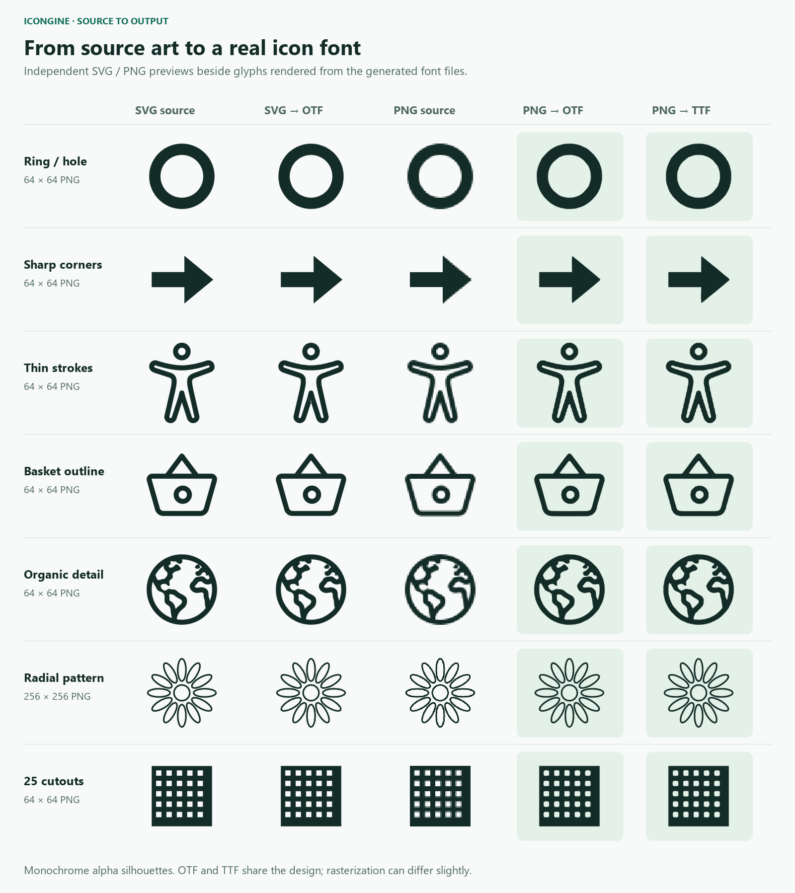
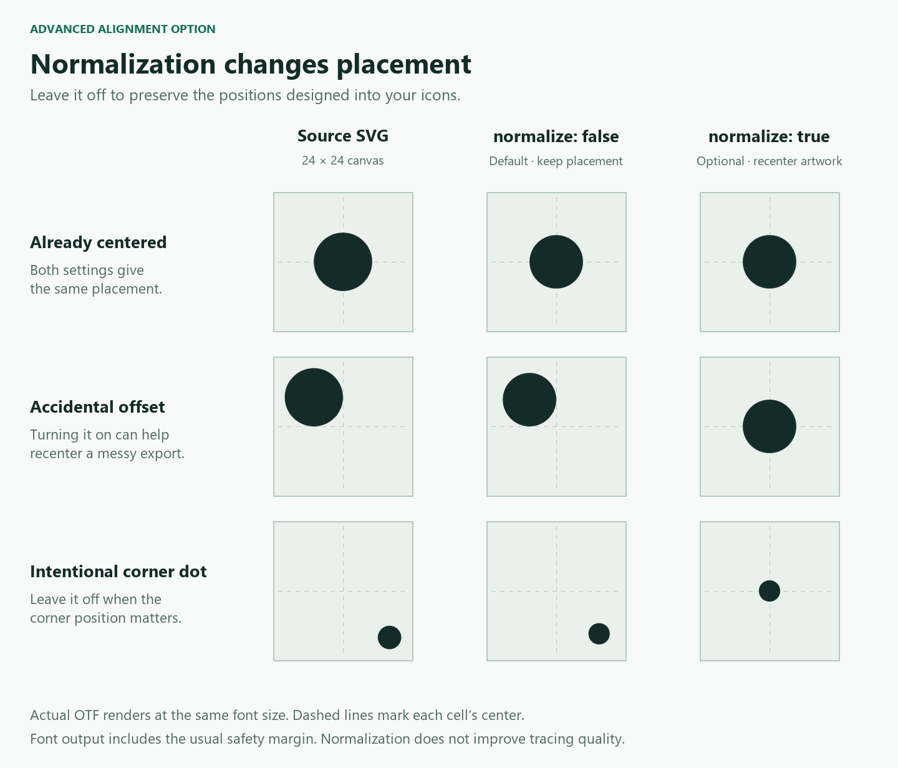

# icongine

Generate TTF/OTF icon fonts and typed Flutter `IconData` from SVGs and transparent
PNGs. Includes smooth PNG tracing, automatic app setup, and multiple font sets.

## Quick start

Add your source icons to `assets/icons`, then run from your Flutter app root:

```sh
flutter pub add dev:icongine
dart run icongine init --input-dir assets/icons --output-font assets/fonts/icons.otf
```

`init` saves the configuration, registers the font in `pubspec.yaml`, and
generates `lib/app_icons.dart`. Use a `.ttf` destination for TTF output.

```dart
import 'package:flutter/widgets.dart';
import 'app_icons.dart';

const icon = Icon(AppIcons.home, size: 24); // From home.svg or home.png.
```

After changing icons, regenerate with `dart run icongine`. Run Flutter again
after the first generation to bundle the font.

New setups include nested folders, folder-prefixed names, and Flutter icon tree
shaking. Smooth tracing is enabled; source padding and placement are preserved.

## Results

Actual renders from generated OTF and TTF files:



Output is monochrome. PNGs use transparency as the silhouette; RGB colors are
ignored, so use a transparent background.

## Multiple sets

Give each set a name, source folder, and font destination:

```sh
dart run icongine init --set ui --input-dir assets/ui --output-font assets/fonts/ui.ttf
dart run icongine init --set brands --input-dir assets/brands --output-font assets/fonts/brands.ttf
```

These produce `UiIcons` and `BrandsIcons` in separate Dart files and register
both fonts. Regenerate all sets with `dart run icongine`, or just one with
`dart run icongine --set brands`.

## PNG quality

Start with **64×64 for ordinary icons** or **128×128 for detailed shapes**.
Simple icons can work at 16–32px; fine patterns may need 256–512px or SVG.
Upscaling a tiny PNG cannot recover missing detail. For intentional pixel art,
set `png_tracing: pixel` in your configuration.

<details>
<summary>Compare PNG source sizes</summary>


Results depend on the source artwork.

</details>

## Configuration

`init` writes the settings for you. For custom paths, package-hosted fonts, CLI
overrides, or programmatic generation, see the [configuration reference](doc/configuration.md).
Command help is available with `dart run icongine init --help` and
`dart run icongine generate --help`.

<details>
<summary>Should I enable normalization?</summary>

Usually leave it off. `normalize: true` recenters visible artwork, which can
correct accidental offsets but also moves intentionally positioned marks.
It does not improve PNG tracing or recover detail.



</details>
