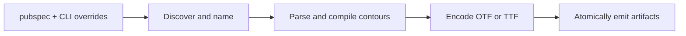

# Architecture

icongine deterministically turns supported icon files into one font artifact
and one typed Flutter API without depending on Flutter at generation time.

## Boundaries

The CLI resolves paths relative to the selected pubspec, reports expected user
errors without stack traces, then invokes the same command layer available to
programmatic callers. It does not contain geometry or font logic.

The domain layer owns validated immutable configuration and deterministic Dart
symbol naming. A source filename must resolve to a non-reserved Dart identifier;
collisions receive stable numeric suffixes in sorted path order.

The pipeline is deliberately sequential: discover populates symbols, compile
produces glyphs and font bytes, and emit writes both artifacts. The mutable
`GenerationState` is scoped to a single run and is the explicit handoff between
those stages.

SVG and PNG inputs converge at glyph compilation. SVG geometry is parsed into
contours; PNG alpha masks become contour loops. Both paths then use the same
normalization, winding, and font writers. TTF and OTF writers share SFNT table
building where their formats permit it.

PNG tracing is selected by `png_tracing` (`smooth` by default). It uses
marching squares over alpha samples at pixel centers, with transparent padding
and alpha saddle disambiguation: isolated diagonal samples join to retain thin
strokes, while thicker regions follow the bilinear saddle to preserve gaps.
Directed edges establish winding without centroid guesses. Curve fitting works
in source-pixel units: at up to 64px, 0.15px polygon simplification and controls
constrained to 0.18px of each chord. Larger sources scale those tolerances up to
0.30px and 0.36px respectively, guided by the [scale study](png-tracing-study.md).
Half-pixel bevels between long perpendicular edges may be restored to sharp
corners. Before accepting a fit, a guard checks confident alpha samples, winding,
nesting, bounds, and crossings on curves sampled at 16 steps. A failed check
retains the interpolated line loops for the whole glyph. More than 128 loops,
16384 raw boundary vertices, or 8192 estimated curve-sampling vertices also
bypass fitting, bounding topology-check costs without dropping details. Soft
alpha samples (25–75%) encode coverage and may change classification within the
fit tolerance. `pixel` bypasses
smoothing and retains exact thresholded pixel boundaries.
Existing custom `GlyphCompilationFacade` implementations keep their contract;
implement `PngTracingGlyphCompilationFacade` to receive the selected PNG mode.

## Invariants

- The same ordered inputs and configuration produce the same code points and
  output bytes on every supported platform.
- Input discovery is sorted before names or code points are assigned.
- Generated Dart identifiers are valid, unique, and never collide with members
  emitted by the class generator.
- Font and Dart outputs cannot target the same path.
- Generated files are staged and replaced as complete files; a caller never
  observes a partially written artifact.
- Paths used for I/O are resolved from the chosen pubspec, while the generated
  setup documentation keeps the font asset path relative to that pubspec.

## Extending the compiler

Add parsing behavior at the SVG/PNG boundary, contour behavior in the contour
package, and container behavior in the relevant font writer. Keep format-neutral
logic out of `formats/`. Every geometry fix needs a minimal fixture plus an
assertion on the invariant that regressed, such as contour count, winding,
bounds, intersections, or emitted operators.

Large files in the geometry and font packages are cohesive numerical
algorithms. Split one only when the extracted component has a distinct contract
and can be tested independently; line count alone is not a reason to fragment
the math.
