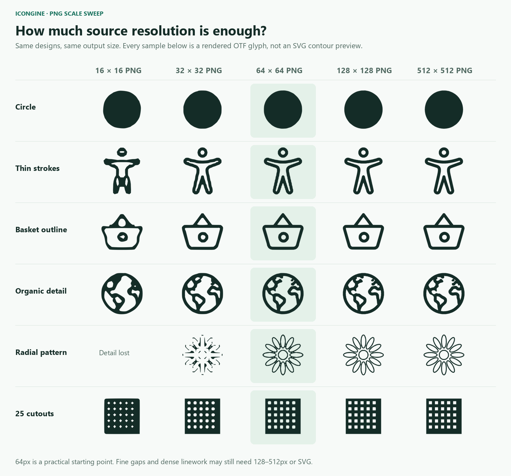

# PNG tracing scale study

Smooth tracing makes 64px a practical starting point for ordinary icons, with
128px preferable for detailed shapes. Very fine gaps still need 256–512px or SVG.
These are fixture-based recommendations, not a minimum size or a universal guarantee.



## Measured results

Eight designs cover circles, rings, sharp corners, thin strokes, a basket,
organic continents, a fine radial pattern, and 25 cutouts. Each design was
independently rasterized at nine source resolutions, then compiled to both OTF
and TTF using both legacy and smooth tracing. Three designs are classed as
simple; five are detailed. All figures show actual FreeType font renders.

| PNG side (px) | Simple median IoU | Detailed median IoU | Detailed topology matches | Median outline segments |
| --- | --- | --- | --- | --- |
| 16 | 95.1% | 77.1% | 3/5 | 47 |
| 24 | 97.1% | 87.5% | 3/5 | 85 |
| 32 | 98.6% | 93.2% | 3/5 | 104 |
| 48 | 98.6% | 95.4% | 3/5 | 136 |
| 64 | 99.1% | 96.6% | 3/5 | 156 |
| 96 | 99.4% | 97.8% | 3/5 | 148 |
| 128 | 99.2% | 98.1% | 3/5 | 130 |
| 256 | 99.4% | 98.6% | 4/5 | 112 |
| 512 | 99.4% | 98.8% | 5/5 | 148 |

IoU is the intersection divided by the union of filled pixels against the
independent SVG reference, measured at 256px with a 50% alpha threshold. Fonts
are rendered at 1024px and downsampled to 256px. Reference SVGs are rendered at
2048px and downsampled, with the same 92% em-square fit. Sources retain the same
geometry and padding at every resolution; small PNGs are not enlarged before
tracing. Topology checks count connected foreground islands and holes; a high
area score can still conceal a closed gap. Exact counts are measured on the
final font render and can vary with rasterization size and quantization.

The detail median improves by only about two percentage points from 64px to
512px on this fixture set, but the finest pattern is a deliberate exception:
its closely spaced petals need 256px to retain all islands and holes. Prefer
SVG when the source is available. Upscaling an existing tiny PNG adds no detail.

OTF and TTF encode the same design using different outline representations.
Their median filled-pixel agreement here is 99.58%;
small antialiasing and quantization differences are expected. The README shows
both formats side by side rather than claiming byte-identical pixels.

## Library behavior

Smooth tracing is the default in pubspec, CLI, and programmatic use. Its alpha
saddle rule keeps nearby thick shapes separate while joining isolated diagonal
stroke samples. Curve acceptance protects confident interior/exterior samples
(alpha ≤25% or ≥75%); soft edge samples may move within the fit tolerance.
Binary inputs retain exact pixel-center coverage. Topology, bounds, winding,
and sampled crossings are checked before a fit is accepted.

Sources up to 64px use 0.15px simplification and 0.18px control deviation.
Larger sources scale those tolerances gradually, capped at 0.30px and 0.36px.
Overly complex or unsafe fits retain interpolated line contours. Pixel mode
keeps exact thresholded boundaries; legacy mode reproduces older PNG output.

## Reproduce

Install Node.js, Dart, and Python, then run from the repository root:

```sh
npm install --prefix tool/png_study
python -m pip install -r tool/png_study/requirements.txt
node tool/png_study/prepare.cjs
dart run tool/png_study/compile.dart
python tool/png_study/render.py
python tool/png_study/publish.py
```

To inspect live font rendering with size and format controls, serve the output
with `python -m http.server 5175 --bind 127.0.0.1 --directory build/png_study`
and open `http://127.0.0.1:5175`.

The study writes inputs, fonts, and individual renders to `build/png_study/`.
The final command refreshes the README images, this report, and the
[measurements](png-tracing-results.json), including source hashes and renderer
versions. Sharp/librsvg supplies independent SVG rasterization; Pillow/FreeType
renders the actual fonts; NumPy measures their masks. No Python or Node runtime
is needed by the library itself. Reruns on another renderer version or platform
may differ slightly.

Existing accessibility, basket, and earth SVGs are from the repository's MIT
Ionicons fixtures. The other geometric patterns are generated by the study.
